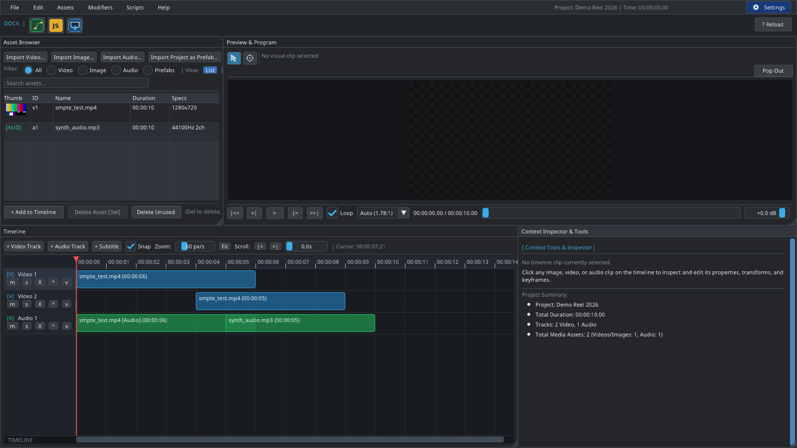

# minicut (v1.5.0)

[English](../README.md) | [العربية](README_ar.md) | [日本語](README_ja.md) | [한국어](README_ko.md) | [Українська](README_uk.md)

**minicut** هو محرر فيديو حديث، فائق السرعة وخفيف الوزن، مصمم خصيصاً لبيئات سطح مكتب لينكس (Linux). يوفر البرنامج تجربة مونتاج سلسة وسريعة الاستجابة لتحرير الفيديو والصوت والصور والنصوص دون تعقيدات غير ضرورية أو اشتراكات شهرية.



---

## الجديد في الإصدار 1.5.0

- 🚀 **محرك رسومي متطور مع Vulkan**:
  - دعم مسرّع بالعتاد عبر Vulkan 1.2+ مع تبديل تلقائي سلس إلى OpenGL 3.3.
- ⚡ **تصدير مباشر عبر الطرفية بدون واجهة (`--render`)**:
  - تصدير مشاريع الفيديو مباشرة عبر سطر الأوامر أو خطوط بناء CI/CD (`minicut --render project.minicut --output out.mp4`).
- 📋 **قائمة انتظار المعالجة الدفعية (Batch Queue)**:
  - تبويب مخصص لإدارة وتصدير عدة مشاريع فيديو بالتتابع دفعة واحدة.
- 🔄 **تحديث فوري للقوالب مسبقة الصنع (Prefab Hot-Reloading)**:
  - تحديث تلقائي لقوالب `.minicut` المشتركة عند تعديلها على القرص مع إمكانية ضبط وتيرة الفحص.
- 🗂️ **عرض شبكي وقائمة لمستعرض الوسائط**:
  - التبديل بسهولة بين بطاقات الصور المصغرة والجدول المفصل لملفات المشروع.
- 🎛️ **قائمة المعدّلات (Modifiers)**:
  - إعادة تنظيم القائمة العلوية لتشمل أدوات الذكاء الاصطناعي ومؤثرات تظليل GLSL والتحويلات.
- 🛠️ **استعادة إعدادات المصنع (`--reconfig`)**:
  - أمر سطر أوامر `minicut --reconfig` لاستعادة الإعدادات الافتراضية بأمان.
- 🔊 **حفظ واسترجاع الصوت عند تحميل المشاريع**:
  - استخراج مسارات الصوت وفك تشفيرها تلقائياً عند فتح المشاريع لحماية المقاطع الصوتية من الفقدان.

---

## قصة التطوير: كيف تم بناؤه (فايب كودينغ)

تم ابتكار وتطوير برنامج `minicut` عبر تجربة برمجة تفاعلية رائدة بطريقة "الفايب كودينغ" (Vibe Coding) بمشاركة المساعد الذكي **Google DeepMind Antigravity**.

انطلاقاً من الفكرة الأساسية، تم بناء التطبيق بالكامل من الصفر باستخدام معيار **C++20** الحديث:
- **العرض الرسومي والواجهة**: محرك رسومي معجل بالعتاد مبني على OpenGL 3.3 بالتعاون مع مكتبة **Dear ImGui** وثيم مستوحى من واجهة KDE Plasma Breeze Dark.
- **محرك الوسائط**: خط معالجة أصلي يعتمد على **FFmpeg** لفك تشفير الإطارات بسرعة فائقة، ومعالجة الصوت، وتصدير الفيديو متعدد المسارات (H.264/AAC و OGG/Theora).
- **الطباعة ودعم اللغات**: عرض متجهات الحروف بدقة عالية عبر **FreeType 2**، مع دعم أصلي كامل لقواعد الخط العربي المتصل واتجاه النص من اليمين إلى اليسار (BiDi)، وتغطية شاملة للغات CJK (اليابانية والكورية).
- **بيئة برمجة مزدوجة**: محركات مدمجة لبرمجة السكربتات بلغة **LuaJIT** و **Duktape JavaScript** لتمكين المستخدم من أتمتة المخطط الزمني وبناء لوحات أدوات تفاعلية مخصصة.

---

## الميزات الرئيسية

- **مخطط زمني متعدد المسارات**: عدد غير محدود من مسارات الفيديو والصوت مع إمكانية إعادة الترتيب وتغيير الأسماء وضبط عمق العرض (Z-Depth).
- **معاينة حية وتحويلات فورية**: شاشة معاينة تفاعلية تتيح التحكم بالموضع والأبعاد وزاوية التدوير ومستوى الشفافية.
- **مولد نصوص FreeType**: أداة مخصصة لإنشاء العناوين والنصوص مع معاينة فورية، حدود خارجية، تباعد الأسطر والحروف، ودعم كامل للخط العربي واللغات الشرقية واللاتينية والسيريلية.
- **إطارات مفتاحية للتحريك (Keyframing)**: تحريك الشفافية، إحداثيات الموضع، مقياس الحجم، ومستوى الصوت باستيفاء خطي سلس.
- **محرك برمجي قابل للتوسع**: إمكانية كتابة الإضافات والأدوات إما بلغة **Lua** أو **JavaScript**:
  - السكربتات في `~/.config/minicut/autorun/` تنشئ أزراراً بأيقونات تلقائياً في **منصة الأدوات (Dock)**.
  - السكربتات في `~/.config/minicut/scripts/` تظهر مباشرة في قائمة **البرمجيات (Scripts)**.
- **دعم واسع للتنسيقات**: MP4, MKV, MOV, WebM, AVI, OGG, OGV, OGM, MP3, WAV, AAC, FLAC, PNG, JPEG, WebP, BMP.
- **واجهة متعددة اللغات**: العربية، الإنجليزية، اليابانية، الكورية، والأوكرانية.

---

## دليل الاستخدام السريع

### 1. التثبيت والتشغيل
لتثبيت البرنامج لحساب المستخدم الخاص بك:
```bash
./install.sh --user
```
شغل `minicut` عبر موجه الأوامر أو من قائمة تطبيقات سطح المكتب:
```bash
minicut
# أو لفتح مشروع موجود:
minicut my_project.minicut
```

### 2. خطوات المونتاج الأساسية

1. **استيراد الوسائط**:
   - اختر **مشروع > استيراد فيديو / صوت / صورة...** أو اسحب الملفات وأفلتها مباشرة داخل النافذة.
   - ستظهر الملفات في لوحة **المقاطع والوسائط**.
2. **إضافة نص**:
   - انقر على زر **إضافة نص** في متصفح الوسائط أو اختر **مشروع > إضافة نص**.
   - اختر الخط، الحجم، الألوان، والتحديد الخارجي والمحاذاة.
   - اضغط **إضافة إلى المخطط الزمني** لإدراج النص عند مؤشر التشغيل.
3. **ترتيب المخطط الزمني**:
   - اسحب المقاطع إلى مسارات الفيديو والصوت.
   - استخدم زر **المسافة (Space)** للتشغيل والإيقاف المؤقت.
   - اضغط على زر **S** لتقسيم المقطع عند موضع المؤشر.
   - اضغط مع الاستمرار على **Ctrl** أو **Shift** لتحديد عدة مقاطع معاً وتحريكها.
4. **التحويل والتحريك بالإطارات المفتاحية**:
   - حدد أي مقطع في المخطط الزمني لمعاينة خصائصه في **لوحة الخصائص**.
   - أضف إطارات مفتاحية للتحكم بالشفافية أو الحركة أو الصوت بمرور الوقت.
5. **استخدام أدوات السكربتات**:
   - انقر على أي أيقونة في **منصة الأدوات (Dock)** لفتح لوحة الأداة التفاعلية.
   - اختر أدوات إضافية من قائمة **البرمجيات (Scripts)**.
6. **تصدير الفيديو النهائي**:
   - اختر **ملف > تصدير الفيديو (.mp4)...** لمعالجة وحفظ الفيديو النهائي.

---

## الدليل والتوثيق البرمجي

تتوفر أدلة مرجعية شاملة ومترجمة لواجهة البرمجة (API) لكل من **Lua** و **JavaScript** بصيغة PDF داخل مجلد `docs/`، ويمكن فتحها مباشرة من قائمة **مساعدة > دليل Lua API** أو **مساعدة > دليل JavaScript API**.
